# Seishin — home-screen widgets promo

<p align="center"></p>

**Video:** [`seishin-widgets-promo.mp4`](seishin-widgets-promo.mp4) — 23 s, 1080×1920 (vertical, for Reels / Shorts / TikTok / Play Store), 30 fps, silent.
**Poster frame:** [`poster.png`](poster.png)

| Scene | Time | Shows |
|---|---|---|
| Title | 0–3 s | Logo, "Your life, organized. Now on your home screen." |
| Home screen | 3–7.5 s | Phone with Quick add, Today, Month and Next up dropping in |
| Tasks | 7.5–11 s | Two tasks ticked off right in the widget |
| Month | 11–14 s | Paging to November and back |
| Themes | 14–17 s | Today widget in Light, Paper, Dark, Midnight, AMOLED |
| Next up | 17–20 s | Countdown to "Now" and the reminder notification |
| End card | 20–23 s | Seishin · 5 new home-screen widgets |

## Screens

| Light | Dark |
|---|---|
| 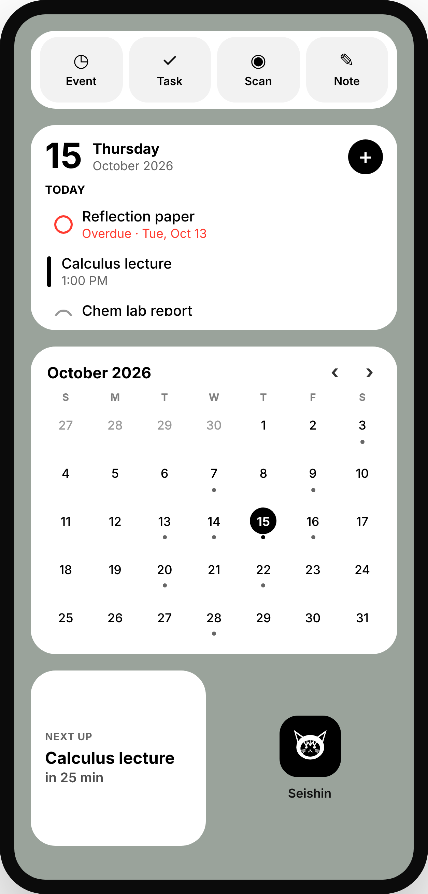 | 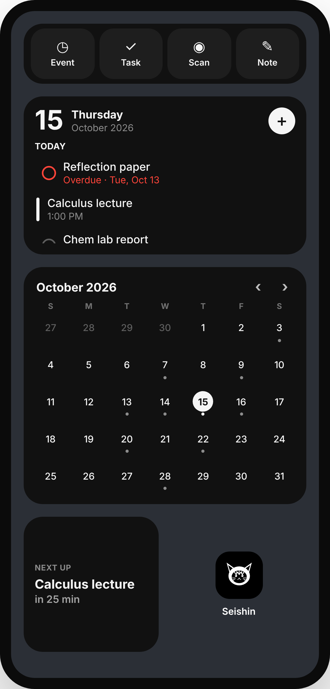 |

| Widget | Light | Dark |
|---|---|---|
| Today (4×2) | 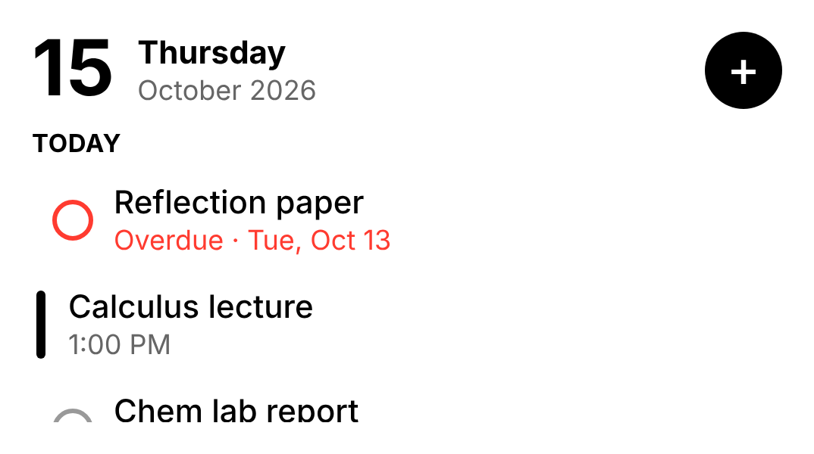 | 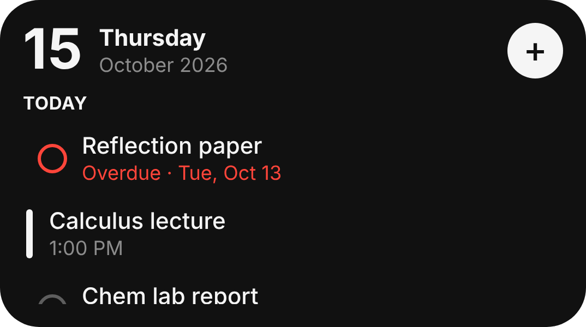 |
| Tasks (4×2) | 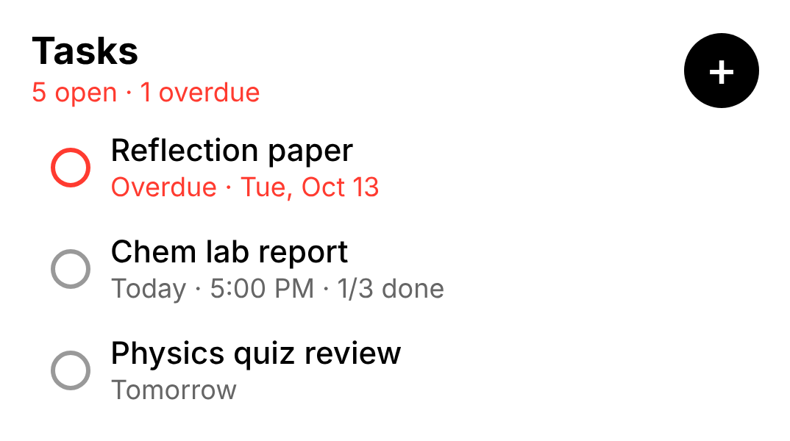 | 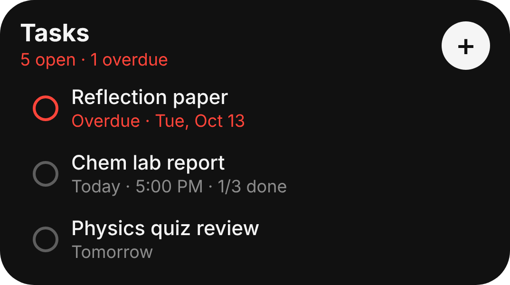 |
| Month (4×3) | 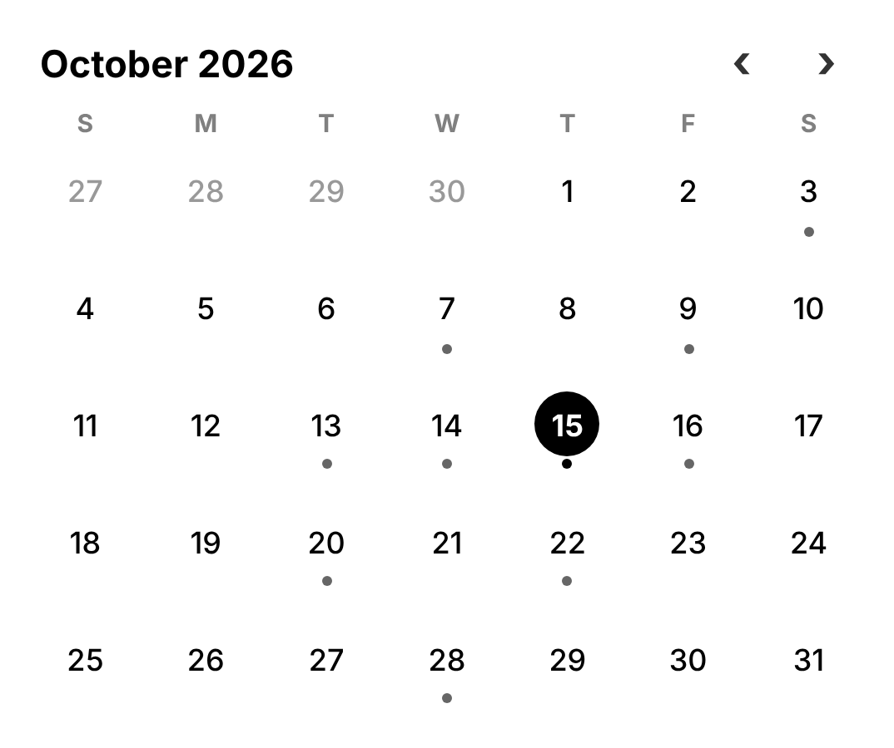 | 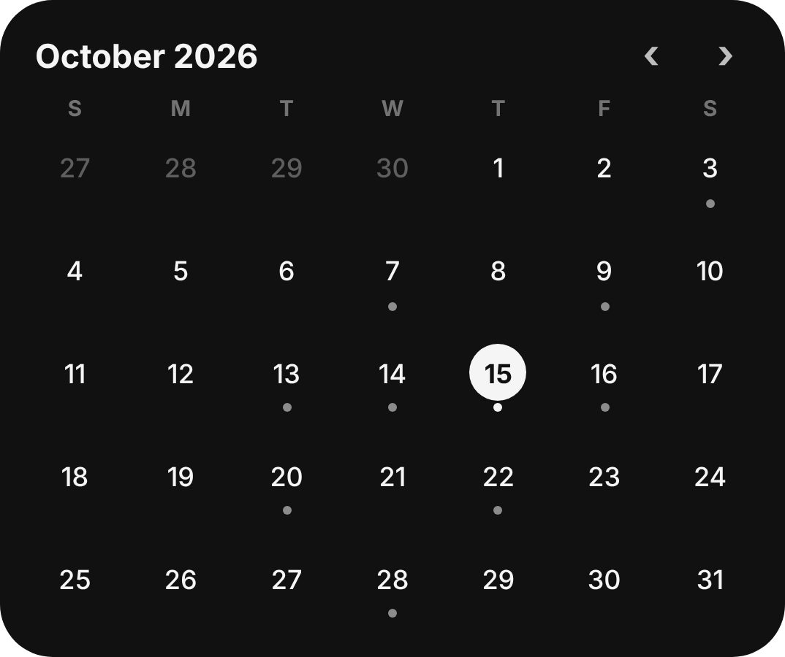 |
| Next up (2×2) |  |  |
| Quick add (4×1) | 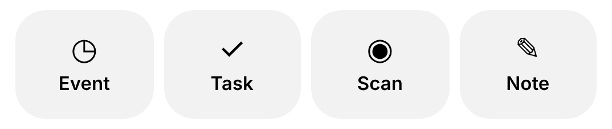 | 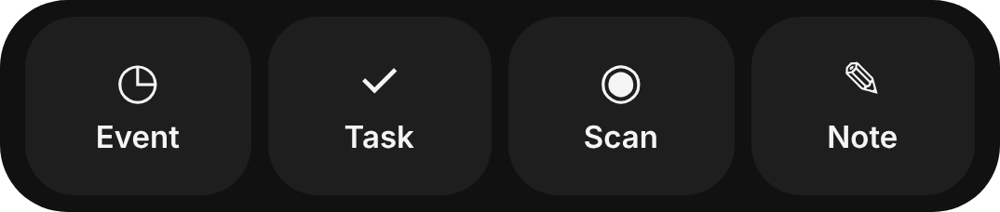 |

Every theme: 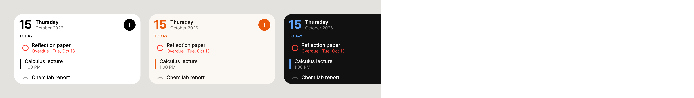

Screens are 3× PNGs with transparent corners, mirroring `src/widgets/*.tsx` (same sizes, colors and copy). Event and task names are sample data.

## Re-rendering

Everything is generated from [`src/scene.html`](src/scene.html), a deterministic HTML animation (`render(t)` draws the frame at *t* seconds):

```sh
node promo/render.mjs           # screens + video + poster
node promo/render.mjs screens   # screens only
```

Needs Playwright with Chromium and `ffmpeg` on `PATH`; uses the Inter font. Open `src/scene.html?t=12` in a browser to preview any moment. The GIF preview is made from the MP4:

```sh
ffmpeg -i promo/seishin-widgets-promo.mp4 -vf "fps=12,scale=360:-1:flags=lanczos,split[a][b];[a]palettegen=max_colors=96[p];[b][p]paletteuse=dither=bayer:bayer_scale=4" promo/preview.gif
```
